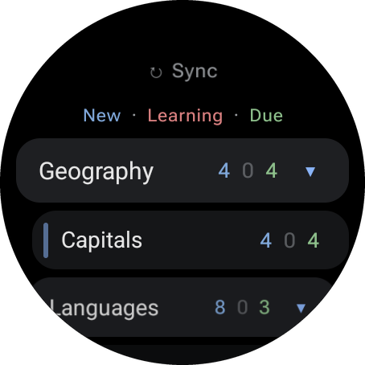
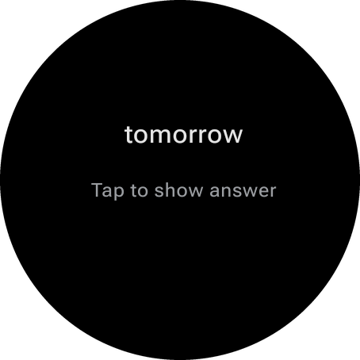
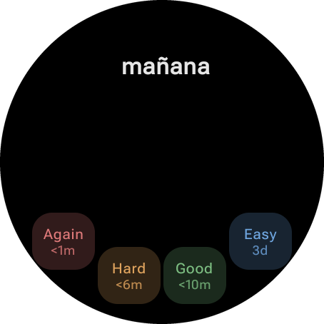
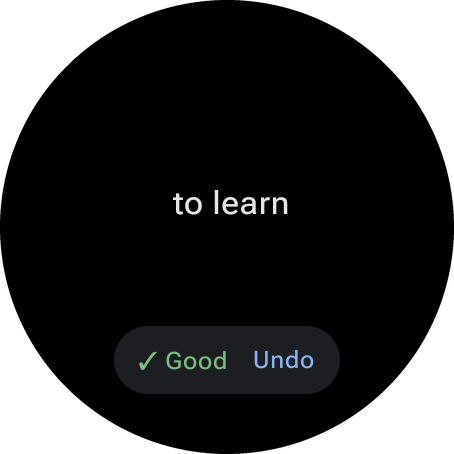
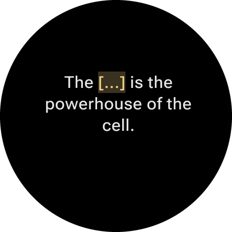
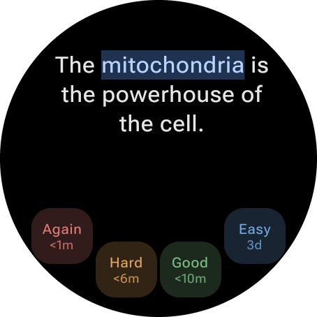
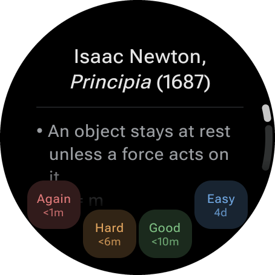
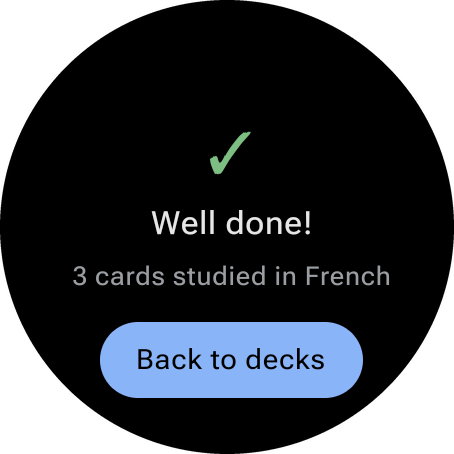
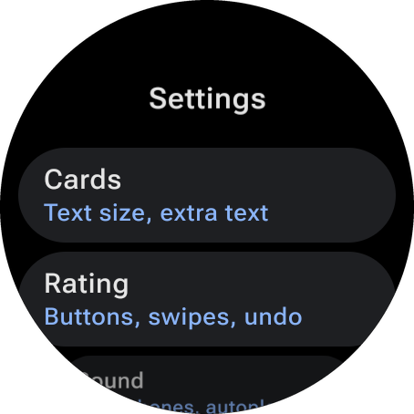
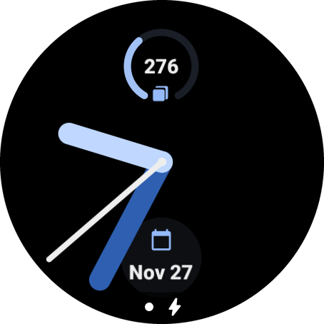

# Wristcards for Anki

A standalone Wear OS app for studying Anki flashcards on your watch. It needs no phone app: cards, media and
review progress come from your Anki sync server (self-hosted or AnkiWeb) and your reviews are synced back.

**Study only:** Wristcards shows and grades existing cards. Adding or editing cards and decks is not possible on
the watch; do that in Anki on your computer or phone and sync.

It runs the official Anki
scheduler (Anki's Rust core via [anki-backend-android](https://github.com/ankidroid/Anki-Android-Backend)),
keeps the collection on the watch and syncs directly with a self-hosted Anki sync server or AnkiWeb.

Not affiliated with Ankitects or AnkiDroid. "Anki" is a trademark of Ankitects Pty Ltd.

## Screenshots

<table>
<tr><td align="center"><br><sub>Deck list</sub></td><td align="center"><br><sub>Question</sub></td><td align="center"><br><sub>Answer with grade buttons</sub></td><td align="center"><br><sub>After grading, with undo</sub></td></tr>
<tr><td align="center"><br><sub>Cloze</sub></td><td align="center"><br><sub>Cloze answer</sub></td><td align="center"><br><sub>Lists</sub></td><td align="center"><br><sub>List answer</sub></td></tr>
<tr><td align="center"><br><sub>Deck finished</sub></td><td align="center"><br><sub>Settings</sub></td><td align="center"><br><sub>Watch face complication</sub></td></tr>
</table>

## Features

- Native card rendering (no WebView): cloze, images, audio, Image Occlusion (native and Enhanced), Ultimate Geography
- Grade buttons with words and next interval, undo, optional swipe grading
- Sync in the background while you study; asks before a full sync could lose data
- Watch face complication with due cards
- 16 languages

## Build

Requires the Android SDK (compileSdk 37.1, build tools 37.0.0) and JDK 17+.

```sh
./gradlew assembleDebug          # debug build (armeabi-v7a + x86_64 for the emulator)
./gradlew assembleRelease        # R8-optimized release (armeabi-v7a; add -Pemulator for x86_64)
./gradlew testDebugUnitTest      # JVM unit tests
```

The debug build can contain a built-in test account from `local.properties` (`sync.endpoint`, `sync.user`,
`sync.password`); release builds never do.

## Tests

- `./gradlew testDebugUnitTest` runs the JVM unit tests.
- The **E2E tests (emulator)** workflow (manual, Actions tab) boots Wear OS 7 and Wear OS 5 emulators, installs
  the debug build with a demo collection ([ci/make_demo_collection.py](ci/make_demo_collection.py)) and drives the
  app from outside via adb ([ci/swipe_test.py](ci/swipe_test.py), 25 cases for what needs the real system; the full
  gesture grid is a unit test, `GesturesTest`) plus a flow test ([ci/flow_test.py](ci/flow_test.py)) against a real
  Anki sync server: download, cloze/list/image rendering, rating and undo in the collection and on the server, and
  the full-sync conflict prompt. It reports the commit status
  `e2e`, which must pass before a pull request can be merged: run it with the pull request's branch as `ref`.

Architecture notes: [architecture.md](architecture.md).

## License

AGPL-3.0-or-later, see [LICENSE](LICENSE). Anki's core is AGPL-3.0; anki-backend-android is GPL-3.0.
