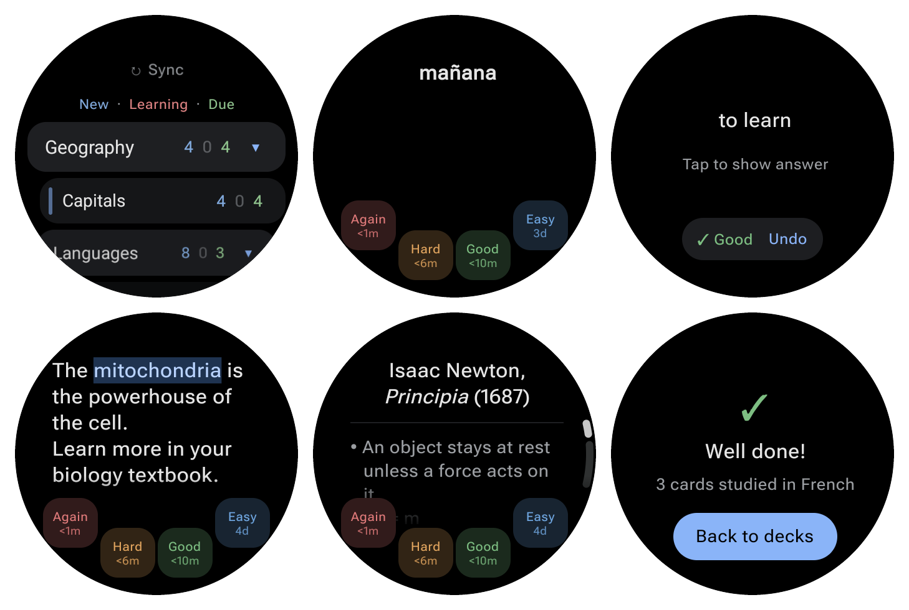

# Wristcards for Anki

A standalone Wear OS app for studying Anki flashcards on your watch. It runs the official Anki
scheduler (Anki's Rust core via [anki-backend-android](https://github.com/ankidroid/Anki-Android-Backend)),
keeps the collection on the watch and syncs directly with a self-hosted Anki sync server or AnkiWeb.

Not affiliated with Ankitects or AnkiDroid. "Anki" is a trademark of Ankitects Pty Ltd.



## Features

- Native card rendering (no WebView): cloze, images, audio, Image Occlusion (native and Enhanced), Ultimate Geography
- Grade buttons with words and next interval, undo, optional swipe grading
- Sync in the background while you study; asks before a full sync could lose data
- Watch face complication with due cards
- 16 languages

## Build

Requires the Android SDK (compileSdk 37.1, build tools 37.0.0) and JDK 17+.

```sh
./gradlew assembleDebug          # debug build (armeabi-v7a + x86_64 for the emulator)
./gradlew assembleRelease        # R8-optimized release (armeabi-v7a; add -Pemulator for x86_64)
./gradlew testDebugUnitTest      # JVM unit tests
```

The debug build can contain a built-in test account from `local.properties` (`sync.endpoint`, `sync.user`,
`sync.password`); release builds never do.

Architecture notes (German): [ARCHITEKTUR.md](ARCHITEKTUR.md).

## License

AGPL-3.0-or-later, see [LICENSE](LICENSE). Anki's core is AGPL-3.0; anki-backend-android is GPL-3.0.
